

  

  <a href="https://www.linkedin.com/in/pervejhosen/"><b>LinkedIn</b></a> &nbsp;·&nbsp;
  <a href="https://www.kaggle.com/pervejhosen"><b>Kaggle</b></a> &nbsp;·&nbsp;
  <a href="https://pervejhosen2.wixsite.com/pervej"><b>Portfolio</b></a> &nbsp;·&nbsp;
  <a href="mailto:pervejhosen2@gmail.com"><b>Email</b></a>

  

  

  

  

  <a href="https://github.com/PervejHosen/SQL_Project-2"></a>
  <a href="https://github.com/PervejHosen/SQL_Project-1"></a>
  <a href="https://github.com/PervejHosen/BigQuery_PythonML_LookerStudio_Projects"></a>
  <a href="https://github.com/PervejHosen/GA4_Looker_Studio_Projects-1"></a>
  <a href="https://github.com/PervejHosen/Excel_Project-2"></a>
  <a href="https://github.com/PervejHosen/Excel_Poject-1"></a>

  

